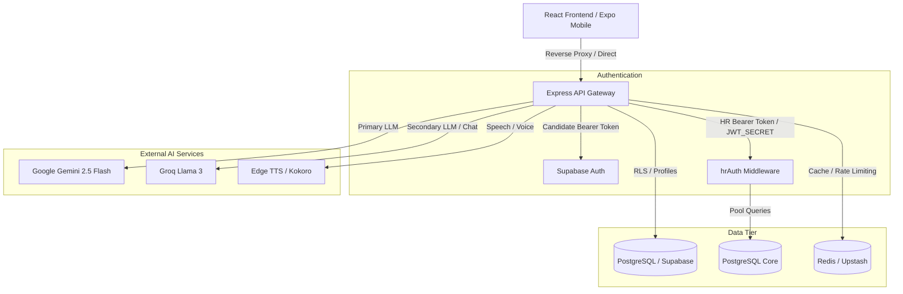

# PrepLoop Architecture Diagram

## FRONTEND LAYER
- React 18 with Vite SPA architecture
- Tailwind CSS styling and Lucide icons
- Monaco, BlockNote, and Tiptap editors
- Three.js 3D visualization and canvas components

## BACKEND LAYER
- Node.js 22 Express REST API Gateway
- PostgreSQL direct connection pool and Supabase PostgREST
- Redis / Upstash caching and distributed rate limits
- AI provider integrations (Gemini, Groq, NVIDIA)

## SECURITY LAYER
- Candidate authentication via Supabase Auth
- Dedicated HR authentication via PostgreSQL and `JWT_SECRET`
- Universal request input sanitization and schema validation
- Double-submit CSRF cookie protection for all state-changing endpoints

