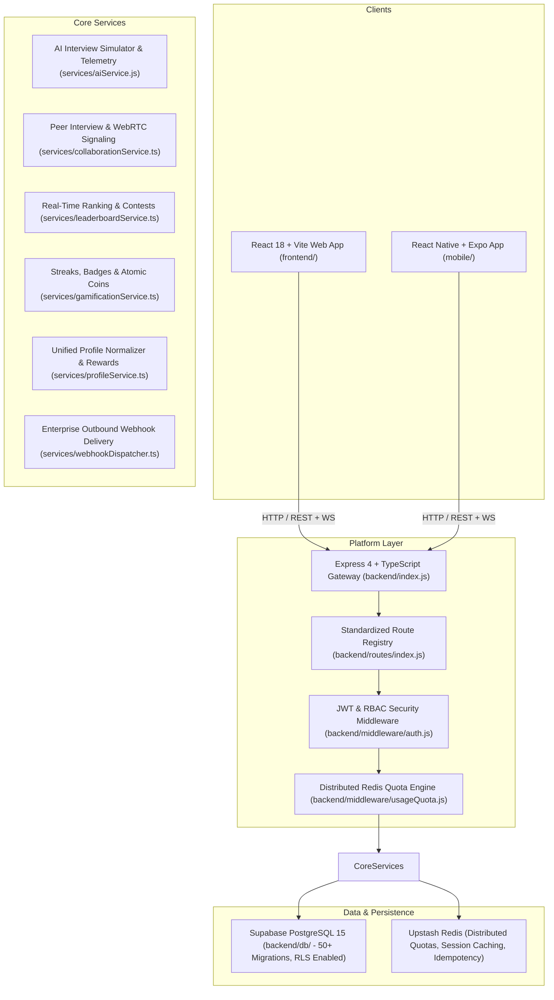

# PrepLoop Engineering & Architecture Documentation

Welcome to the **PrepLoop** developer documentation. PrepLoop is an enterprise-grade AI-powered technical interview preparation, assessment, and coding platform.

---

## 1. System Architecture



---

## 2. Directory Structure

- `frontend/` — React 18 single-page application built with Vite, Tailwind CSS, TipTap/BlockNote rich editors, Monaco editor, and Lucide icons.
- `backend/` — Express API server transitioning to TypeScript, with Redis-backed rate limiting, Joi universal request validation, and AI voice orchestration.
  - `backend/routes/` — Modular REST endpoint definitions centralized in `backend/routes/index.js`.
  - `backend/services/` — TypeScript and ES module business logic for interviews, collaboration, gamification, and portfolios.
  - `backend/db/` — Database migrations, RLS policies, index definitions, and `MIGRATIONS_MANIFEST.md`.
  - `backend/tests/` — Standardized Vitest test runner across `tests/unit/` and `tests/integration/`.
- `mobile/` — React Native Expo application for Android and iOS with native audio streaming and Maestro E2E test suites.
- `scripts/` — Repository maintenance, database backup, and operational runners.
- `docs/` — Architecture documentation, API specifications (`api-spec.json`), and design guides.

---

## 3. Developer Onboarding & Quick Start

### Prerequisites
- **Node.js**: v22.x or v24.x
- **npm**: v10+ or v11+
- **Docker & Compose**: (optional for containerized PostgreSQL and Redis)

### Initial Setup
From the repository root:

```bash
# 1. Install root, backend, and frontend dependencies
npm run install:all

# 2. Configure environment variables (auto-provisions templates if missing)
npm run setup:env

# 3. Verify setup health and guardrails
npm run verify:setup

# 4. Start concurrent development servers (backend:5000 + frontend:5173)
npm run dev
```

---

## 4. Testing Infrastructure

PrepLoop enforces standardized automated testing across web, backend, database, and mobile:

### Backend Testing (Vitest)
```bash
# Run all unit and integration test suites
npm --prefix backend run test

# Run tests with V8 code coverage report
npm --prefix backend run test:coverage

# Run TypeScript type verification
npm --prefix backend run type-check

# Run ESLint validation
npm --prefix backend run lint
```

### Frontend Testing (Vitest & Playwright)
```bash
# Run component and utility unit tests
npm --prefix frontend run test

# Run tests with coverage
npm --prefix frontend run test:coverage

# Run Playwright End-to-End browser tests
npm --prefix frontend run test:e2e
```

### Mobile Testing (Node & Maestro E2E)
```bash
# Run mobile API client unit tests
npm --prefix mobile run test

# Run Maestro mobile E2E flows (Android / iOS)
npm --prefix mobile run test:e2e
```

### Database Query & Security Tests
Database schema validation, index presence, atomic coin transaction idempotency, and Row Level Security policies are automatically verified in:
`backend/tests/integration/databaseMigrationAndRls.test.ts`

---

## 5. API Documentation & OpenAPI Specification

- **Swagger UI Interactive Explorer**:
  Available locally when backend is running at:
  `http://localhost:5000/api/docs`
- **Raw OpenAPI 3.0 JSON**:
  `http://localhost:5000/api/docs/openapi.json`
- **Generate Offline API Spec**:
  ```bash
  npm run docs:api
  ```
  Generates `docs/api-spec.json` and `docs/api-spec.html`.

---

## 6. Continuous Integration & Deployment (CI/CD)

The GitHub Actions workflow (`.github/workflows/ci.yml`) runs on every push and pull request to `main`:
1. **Type Checking**: Runs `tsc --noEmit` across backend TypeScript services and schemas.
2. **Linting**: Checks backend and frontend code quality via ESLint.
3. **Vitest Suites**: Executes backend unit and integration tests.
4. **Frontend Unit Tests**: Runs all Vitest frontend suites with jsdom.
5. **Production Build**: Bundles frontend via Vite rollup with bundle size budget checks.
6. **DSA Editor Smoke Tests**: Boots an ephemeral backend server and executes smoke verification workflows.
